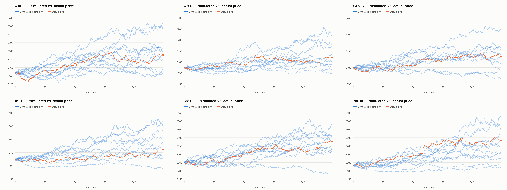

# Portfolio Projection Tool

A Java Monte Carlo simulator that models a portfolio of stocks as a system of **correlated geometric Brownian motions**. It estimates each stock's drift and volatility from historical daily prices, builds the covariance (covolatility) matrix between them, and then simulates price paths with the **Euler–Maruyama** method.

The repository includes one year (250 trading days) of daily closing prices for six tech stocks: AAPL, AMD, GOOG, INTC, MSFT and NVDA.



## How it works

1. **Load prices.** `StockData.txt` is parsed into one price series per stock.
2. **Compute log returns.** For each stock, $r_t = \ln(S_{t+1} / S_t)$.
3. **Estimate parameters.** These are annualized assuming 250 trading days per year:
   - Drift: $\hat{\mu} = 250 \cdot \overline{r}$
   - Squared volatility: $\hat{\sigma}^2 = 250 \cdot \mathrm{Var}(r)$
4. **Build the covolatility matrix.** The diagonal holds each stock's $\hat{\sigma}^2$. Each off-diagonal entry is the annualized covariance of log returns between a pair of stocks, $C_{ij} = 250 \cdot \mathrm{Cov}(r_i, r_j)$.
5. **Take the matrix square root.** An eigenvalue decomposition $C = V D V^\top$ gives $C^{1/2} = V D^{1/2} V^\top$, which turns independent Gaussian samples into correlated shocks.
6. **Simulate.** Prices are stepped forward with Euler–Maruyama on the SDE system

$$
dS = \left(\mu + \tfrac{1}{2}\sigma^2\right) \odot S \, dt \;+\; S \odot \left(C^{1/2} \, dW\right)
$$

   using a time step of $\Delta t = 1 / (250 \cdot k)$, where $k$ is the upsample factor.

## Project structure

```
.
├── lib/
│   └── Jama-1.0.3.jar
├── src/financeproject2/
│   ├── Main.java
│   ├── GatherDriftsAndVolatilities.java
│   ├── CovolatilityMatrixCalculator.java
│   ├── SDESystem.java
│   ├── NumericalSDESolution.java
│   └── TrajectoryPlotter.java
├── docs/
│   └── example_plots.png
└── StockData.txt
```

| File | Purpose |
| --- | --- |
| `Main.java` | Entry point. Loads data, runs the pipeline and writes the output. |
| `GatherDriftsAndVolatilities.java` | Computes log returns and annualized drift and volatility. |
| `CovolatilityMatrixCalculator.java` | Builds the annualized covariance matrix across all stocks. |
| `SDESystem.java` | Holds the SDE parameters and computes the matrix square root. |
| `NumericalSDESolution.java` | Runs one Euler–Maruyama simulation of every stock. |
| `TrajectoryPlotter.java` | Draws the simulated paths against the actual prices as PNG charts, using only the Java standard library. |
| `lib/Jama-1.0.3.jar` | [JAMA](https://math.nist.gov/javanumerics/jama/), a public-domain matrix library from NIST, bundled so the project builds with no extra downloads. |
| `StockData.txt` | Sample input: 250 daily closing prices for six stocks. |

## Requirements

- Java 8 or newer (JDK)

## Building and running

From the project root:

```bash
# Compile
javac -cp lib/Jama-1.0.3.jar -d out src/financeproject2/*.java

# Run (macOS / Linux)
java -cp "out:lib/Jama-1.0.3.jar" financeproject2.Main

# Run (Windows: use ; instead of : as the classpath separator)
java -cp "out;lib/Jama-1.0.3.jar" financeproject2.Main
```

Run the program from the directory that contains `StockData.txt`, because the file is read by relative path.

## Output

**Console.** The program prints:
- the estimated drift of each stock
- the estimated squared volatility of each stock
- the square root of the covolatility matrix
- one simulated trajectory, one row per day, with one tab-separated column per stock

**`SimulatedTrajectories.txt`.** For each stock, the program writes 10 independent simulated paths followed by the real historical prices, one row per day:

```
AAPL
<sim 1>  <sim 2>  ...  <sim 10>  <actual price>
...
```

The file is tab-separated, so you can paste it into a spreadsheet for further analysis.

**`plots/`.** The program saves the same 10 simulations as charts:
- `plots/<TICKER>.png`: one chart per stock, with the simulated paths in blue and the actual price in orange
- `plots/all_stocks.png`: an overview grid of every stock, like the image at the top of this README

Each run draws new random paths, so the files are overwritten every time.

## Using your own data

Edit `StockData.txt`, or replace it with a file of the same name. Each security is a label line followed by its daily prices inside braces, one price per line:

```
AAPL apple
{
147.770004
147.070007
...
}

MSFT microsoft
{
...
}
```

- You can include any number of securities.
- Every security must have the **same number of daily prices**.
- The first word of the label line (for example `AAPL`) is used as the stock's name in the output file and plots.

## Configuration

These settings are currently hard-coded in `Main.java`:

| Setting | Default | Description |
| --- | --- | --- |
| `upSampleFactor` | `1` | Number of simulation steps per trading day. Higher values give a finer time step. |
| Number of trajectories | `10` | Number of paths written to `SimulatedTrajectories.txt` and plotted. |
| Input file | `StockData.txt` | Path to the price data. |
| Plot directory | `plots` | Folder the PNG charts are written to. |

## Limitations

- Parameters are estimated assuming 250 trading days per year.
- Simulations cover the same number of days as the input data. They do not project past the end of the historical window.
- The model assumes constant drift and volatility (GBM). It does not capture fat tails, volatility clustering or regime changes, so treat the output as an educational illustration rather than a forecast.
